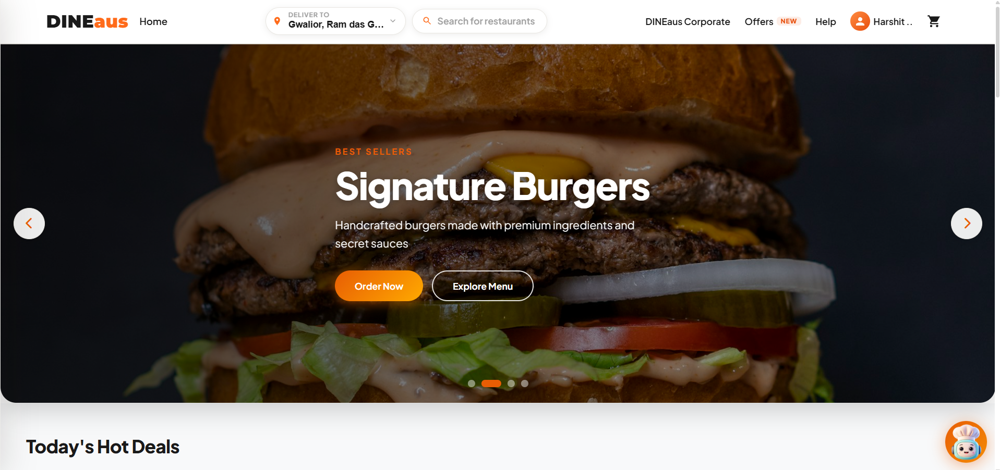
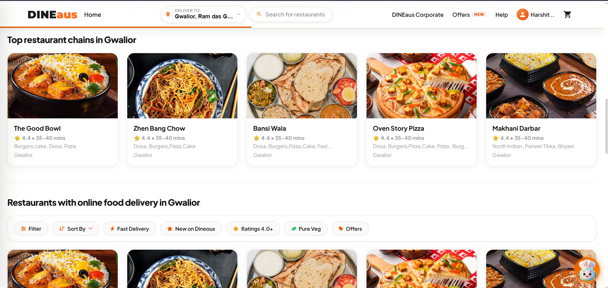
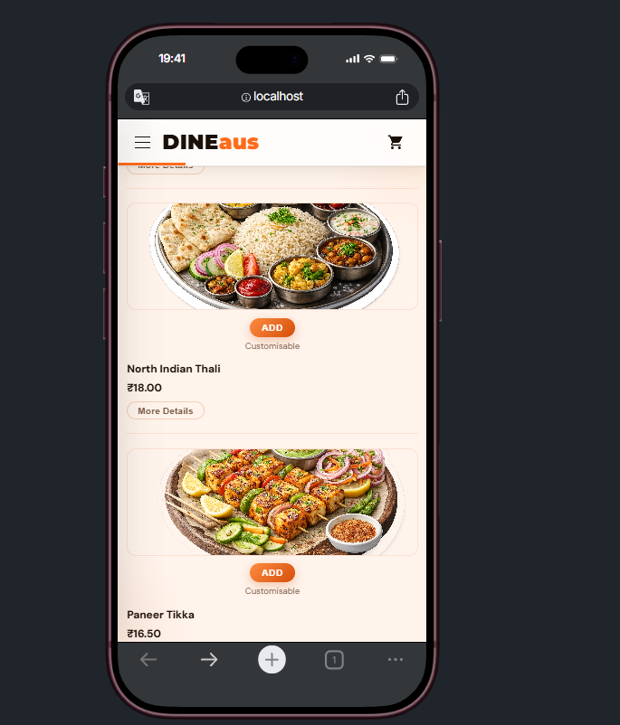
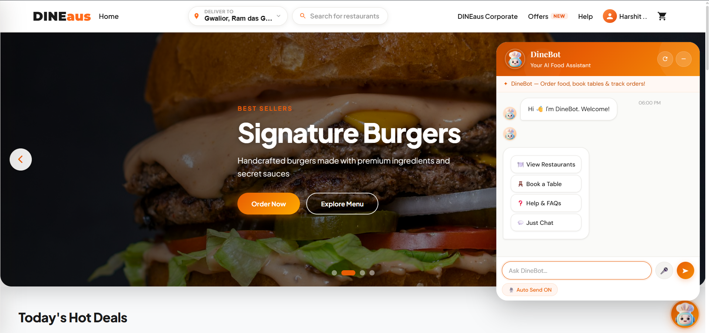
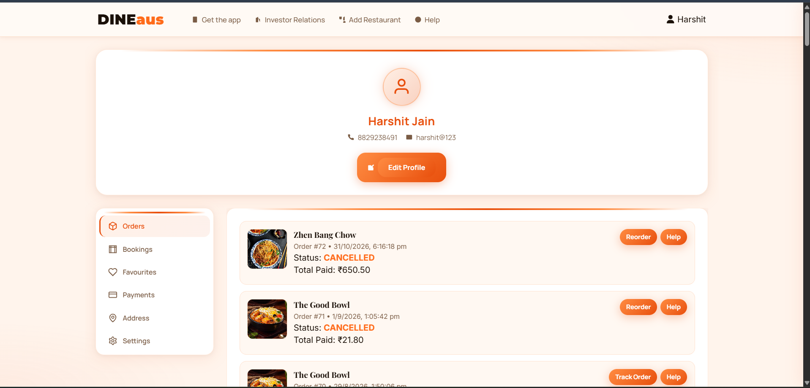
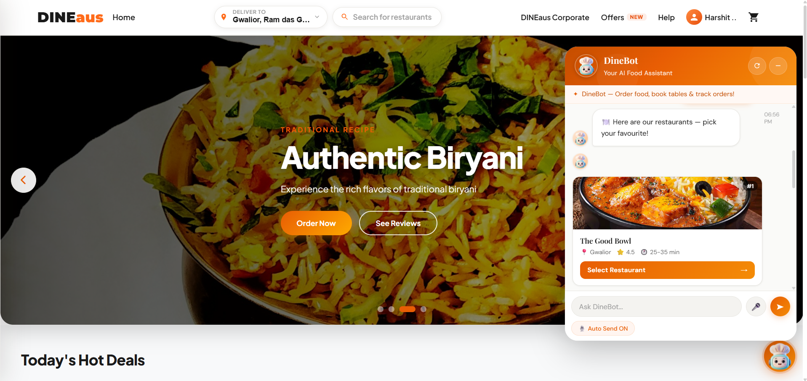
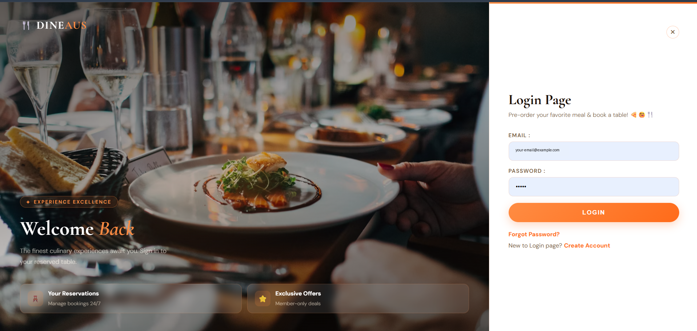
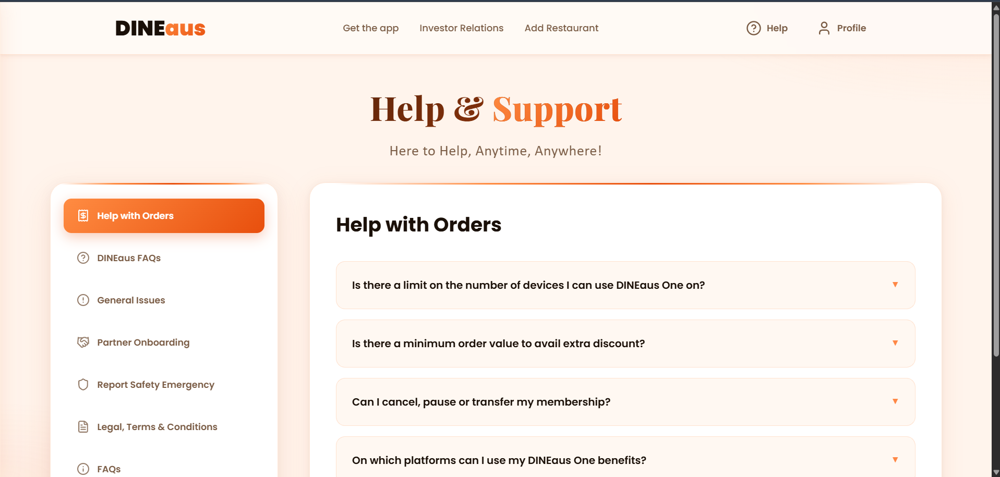
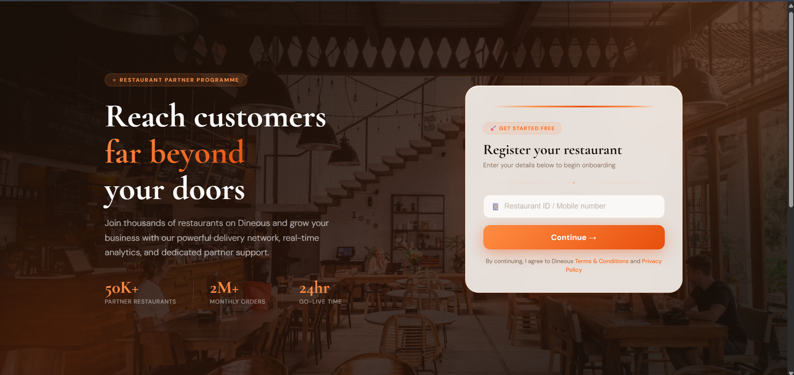
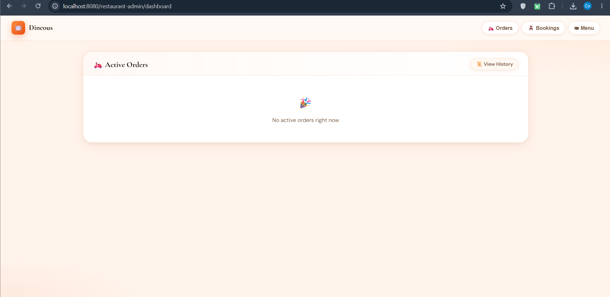

# 🍽️ DINEaus

### A full-stack food ordering, restaurant operations, and table booking platform

DINEaus brings the customer journey and restaurant operations into one web application: discover a place to eat, browse its menu, build a cart, place or schedule an order, reserve a table, and follow order progress. Separate portals support restaurant teams, delivery partners, and platform administrators.

This project represents a year of building, learning, and iterating. The web app uses **Node.js, Express, EJS, and MySQL**; **DineBot**, its AI-assisted food chat companion, runs as a separate **Python Flask** service. **Socket.IO** connects the live parts of the experience.

> **Project status:** A learning and portfolio project that runs locally with a configured MySQL database and service environment. Screenshots below are development captures; sample names and order details are illustrative. No public demo credentials are included.

<p align="center">
  
  
  
  
  
  
  
</p>

## Contents

- [Product tour](#product-tour)
- [At a glance](#at-a-glance)
- [What the application does](#what-the-application-does)
- [Architecture](#architecture)
- [DineBot: NLP and conversation flow](#dinebot-nlp-and-conversation-flow)
- [Database overview](#database-overview)
- [Repository guide](#repository-guide-and-inventory)
- [Run locally on Windows](#run-locally-windows)
- [Main web routes](#main-web-routes)
- [Technical decisions and current limitations](#technical-decisions-and-current-limitations)

## Product tour

The gallery uses screenshots captured from the local application. Account identifiers are removed from the login capture; order and restaurant data shown elsewhere is sample development data.

### Home and discovery

<p align="center">
  
</p>

<p align="center">
  
  
</p>

### DineBot — the AI food assistant

<p align="center">
  
</p>

<p align="center">
  
  
</p>

### Account, help, and restaurant operations

<p align="center">
  
  
</p>

<p align="center">
  
  
</p>

> Signup and password-recovery pages are part of the application; their screenshots are not included in this capture set. Table booking is supported in both the customer flow and DineBot conversation, as described below.

## At a glance

| Area | What it does |
|---|---|
| Customer web app | Restaurant discovery, menu browsing, cart, checkout, order tracking, reservations, profile, and help |
| Restaurant portal | Partner onboarding, order handling, booking management, menu operations, and order history |
| Delivery portal | Delivery partner registration, assigned orders, delivery status updates, and location sharing |
| Platform admin | Restaurant application review and approval workflows |
| DineBot | Conversational restaurant discovery, menu and cart actions, order lookup, and table booking |
| Data store | MySQL schema for customers, restaurants, menus, carts, orders, bookings, seats, and partners |
| Live events | Socket.IO events for order, booking, and delivery progress |

## What the application does

### Customer experience

- Browse approved restaurants and their menus; search restaurants and dishes.
- Add menu items to a session-based guest cart or a signed-in customer's database cart. The login flow attempts to merge a guest cart into the account cart.
- Choose a saved delivery address and place an order. The order flow supports immediate and scheduled orders.
- View the order timeline and receive Socket.IO status and delivery-location events.
- Reserve a restaurant table by date, time, party size, and seat preference; optionally add food to the reservation.
- Manage profile details, addresses, order history, bookings, reorder, and password recovery.
- Ask DineBot for restaurant discovery, menu information, item recommendations, cart actions, order tracking, cancellation guidance, and table booking.

### Restaurant staff

- Submit restaurant details and onboarding information.
- Review incoming orders, update order status, manage bookings, and maintain menu items.
- Receive new-order and booking events through restaurant-specific Socket.IO rooms.

### Delivery partners

- Register and sign in to a delivery workflow.
- View available work, accept an order, and move it through pickup, out-for-delivery, and delivered states.
- Share delivery coordinates for the customer tracking view.

### Platform administration

- Review restaurant applications and approve or reject them.
- View platform-level restaurant information in an admin dashboard.

## Architecture

```text
Customer / staff browser
  ├── HTTP + Socket.IO ──> Express app (collegeP, port 8080)
  │                         ├── Routes, sessions, access middleware
  │                         ├── Controllers and MySQL queries
  │                         ├── EJS pages and static assets
  │                         └── node-cron scheduled-order job
  │
  └── HTTP fetch ─────────> Flask chatbot (foodin-chatbot, port 5000)
                            ├── Intent routing and conversation state
                            ├── TF-IDF + Logistic Regression classifier
                            ├── Entity extraction and chatbot actions
                            └── OrderManager

                 Express and Flask both connect to the configured MySQL database
```

`collegeP/index.js` starts Flask as a child process using `foodin-chatbot/venv/Scripts/python.exe`. The chatbot widget in the browser sends its `/chat` and `/reset` requests directly to Flask with `fetch`; the Flask app does not receive its messages from Express. Both services access MySQL independently. The current widget uses `http://localhost:5000`, so a remote deployment needs a matching public chatbot URL and a restricted CORS origin.

### Example: placing an order

1. The browser opens a restaurant page. Express loads restaurant and menu rows from MySQL and renders the EJS view.
2. The customer adds items. Guest cart state lives in the session; signed-in cart state is stored in `cart_items`.
3. At checkout, the controller reads the cart and selected address, creates an order, and notifies the restaurant room through Socket.IO.
4. Restaurant staff update the order lifecycle. The tracking page receives order status and delivery-location events and refreshes its display.

### Example: chatting with DineBot

1. The widget sends the message and conversation identifier to Flask as JSON.
2. The router checks active booking/order context and deterministic keyword rules, then can use the intent classifier. Low-confidence or ambiguous input may be sent to the optional Groq fallback.
3. The chatbot extracts relevant values, such as a menu item, quantity, order ID, party size, date, or time.
4. A handler reads or updates chatbot session state and uses `OrderManager` for relevant database actions.
5. Flask returns JSON. The browser renders the reply and any restaurant, menu, or cart cards.

## DineBot: NLP and conversation flow

### Intent classification

`foodin-chatbot/train_chatbot.py` trains a scikit-learn pipeline from patterns in `foodin-chatbot/data/intents.json`:

```python
make_pipeline(
    TfidfVectorizer(ngram_range=(1, 2), stop_words="english"),
    LogisticRegression(max_iter=2000),
)
```

The saved `chatbot_model.pkl` contains the pipeline and label encoder together. At runtime, `chatbot/intent_router.py` first handles state and rule patterns, then uses the model and its confidence; it can ask the Groq LLM for help with uncertain/free-form messages when configured. Rules keep common actions such as greeting, menu, order, tracking, and booking predictable.

### Entity extraction

`chatbot/entity_extractor.py` combines regular expressions, English/Hinglish number-word mappings, optional spaCy noun/POS processing, and `difflib` fuzzy matching. It can extract order IDs, item names and quantities, and booking information such as guest count, date, time, and seat preference. spaCy is optional at runtime; without its English model, the regex fallback remains available.

Examples the parser is designed to handle include:

| Message | Extracted information |
|---|---|
| `2 burgers` | quantity `2`, food item `burger` |
| `char log kal 7 baje` | 4 guests, tomorrow, 19:00 |
| `track order 1023` | order ID `1023`, tracking intent |

### Conversation state and actions

The session manager retains context such as the selected restaurant, temporary cart, booking details, and recent intent. This allows the bot to ask follow-up questions when required fields are missing. The Flask API exposes `POST /chat`, `POST /reset`, and `GET /health`.

## Database overview

The SQL files define 12 tables. In the current schema, `one` stores customer accounts and the address table is named `Address` (capital A).

| Table | Purpose |
|---|---|
| `one` | Customer accounts and password-reset fields |
| `Address` | Customer delivery addresses and coordinates |
| `restaurant` | Restaurant details, location, and approval status |
| `menu_item` | Menu item names, prices, images, cuisine, and availability |
| `cart_items` | User/restaurant/menu item quantities |
| `orders` | Order data, status, schedule, and delivery coordinates |
| `reservations` | Table bookings, party size, time, seat, and status |
| `restaurant_seats` | Restaurant seating options and availability |
| `reservation_preorders` | Items attached to a reservation |
| `restaurant_admin` | Restaurant staff/admin accounts and roles |
| `delivery_partner` | Delivery partner profiles and account data |
| `platform_admin` | Platform administration accounts |

The schema uses relational IDs and foreign keys in several of these relationships. An order's status enum includes `scheduled`, `pending`, `accepted`, `preparing`, `ready`, `picked_up`, `out_for_delivery`, `delivered`, `completed`, `rejected`, and `cancelled`.

## Repository guide and inventory

Views are grouped by customer, restaurant, delivery, and platform-admin workflows. Shared layout, navigation, flash-message, and error templates support those pages.

```text
DINEaus/
├── README.md
├── docs/screenshots/             # Product-tour captures used in this README
├── collegeP/                     # Express web application
│   ├── index.js                  # Startup, middleware, routes, Socket.IO, cron, Flask child process
│   ├── routes/                   # URL/method to controller mappings
│   ├── controllers/              # Customer, restaurant, delivery, and admin logic
│   ├── middlewares.js            # Session/role checks and navigation behavior
│   ├── config/db.js              # MySQL connection pool
│   ├── views/                    # EJS pages and shared layout/include files
│   ├── public/                   # Browser code, styles, images, and chatbot widget
│   ├── schemas/                  # Six SQL schema/setup files
│   └── cron/scheduledOrders.js   # Activates due scheduled orders once per minute
└── foodin-chatbot/               # Flask conversational service
    ├── app.py                    # Chat API and intent-to-action orchestration
    ├── order_manager.py          # Chatbot database operations
    ├── train_chatbot.py          # TF-IDF/classifier training
    ├── chatbot/                  # Routing, extraction, response, model, booking, and sessions
    └── data/                     # Intent examples, model artifact, LLM prompt, session file
```

## Run locally (Windows)

### Requirements

- Node.js and npm
- Python 3.9 or newer
- MySQL 8 or a compatible MySQL server
- Optional: a Groq API key for the LLM fallback

### 1. Create the database

From a MySQL client, create the database and run each schema file in order from the repository root:

```sql
CREATE DATABASE college_practice;
USE college_practice;
SOURCE collegeP/schemas/schema.sql;
SOURCE collegeP/schemas/schema3.sql;
SOURCE collegeP/schemas/schema4.sql;
SOURCE collegeP/schemas/schema5.sql;
SOURCE collegeP/schemas/schema6.sql;
```

The checked-in `collegeP/schemas/run_all.sql` currently has machine-specific `SOURCE` paths; use the explicit commands above from the repository root instead.

### 2. Configure the Node app

Create `collegeP/.env`:

```env
DB_HOST=127.0.0.1
DB_PORT=3306
DB_USER=root
DB_PASSWORD=your_mysql_password
DB_NAME=college_practice
```

Install Express dependencies from the `collegeP` directory:

```powershell
cd collegeP
npm install
```

### 3. Configure the chatbot service

In a second terminal, create the Python environment and install its packages:

```powershell
cd foodin-chatbot
python -m venv venv
.\venv\Scripts\Activate.ps1
pip install -r requirements.txt
python -m spacy download en_core_web_sm
```

Create `foodin-chatbot/.env` with database credentials. The Python service reads `DB_PASS`, while the Node app uses `DB_PASSWORD`:

```env
DB_HOST=127.0.0.1
DB_PORT=3306
DB_USER=root
DB_PASS=your_mysql_password
DB_NAME=college_practice
GROQ_API_KEY=your_groq_api_key
GROQ_MODEL=llama-3.1-8b-instant
USE_GROQ=true
```

`GROQ_API_KEY` is optional; without it, local intent/rule handling remains available. When the configured Python virtual environment exists, starting the Node app launches Flask at port 5000. Open [http://localhost:8080/home](http://localhost:8080/home). The current child-process path is Windows-specific (`venv/Scripts/python.exe`).

The trained pipeline is already stored at `foodin-chatbot/data/chatbot_model.pkl`. To retrain it, run `python train_chatbot.py` from the `foodin-chatbot` directory.

### 4. Start the application

After MySQL, both environment files, npm packages, and the Python virtual environment are ready, start Express from `collegeP`:

```powershell
cd collegeP
node index.js
```

Express starts the Flask child process. Open [http://localhost:8080/home](http://localhost:8080/home).

## Main web routes

| Area | Example routes |
|---|---|
| Customer account | `/sign`, `/login`, `/logout`, `/forgot`, `/reset-password` |
| Browse and cart | `/home`, `/restaurant/:id`, `/search`, `/search-ajax`, `/cart/checkout`, `/cart/update`, `/cart/remove` |
| Order and profile | `/payment`, `/payment/success`, `/profile`, `/track-order/:id`, `/orders/reorder/:orderId` |
| Table booking | `/reserve/:id`, `/reservation/slots`, `/reservation/create-full`, `/booking/:id/cancel` |
| Restaurant admin | `/restaurant-admin/login`, `/restaurant-admin/dashboard`, `/restaurant-admin/order/:id/accept`, `/restaurant-admin/orders/history` |
| Delivery partner | `/delivery/register`, `/delivery/login`, `/delivery/dashboard/:id`, `/delivery/order/:id/pickup` |
| Platform admin | `/platform-admin/login`, `/platform-admin/dashboard`, `/platform-admin/approve/:id` |

The Flask endpoints are `POST /chat`, `POST /reset`, and `GET /health` on port 5000.

## Technical decisions and current limitations

- **Server-rendered EJS:** Express can load data and return a complete page, while browser JavaScript handles interactive behavior.
- **Two language runtimes:** the existing web workflows remain in Node.js, while the Python service uses scikit-learn and NLP libraries for DineBot.
- **Socket.IO rooms:** order, restaurant, booking, and user room names target events to connected clients interested in that record.
- **Parameterized SQL:** controllers and the chatbot use query parameters for many database values; use this consistently for every query.
- **Development hardening still needed:** the Express session secret is currently hard-coded, Flask CORS allows all origins, and Socket.IO room joins/location updates need stronger ownership checks before public deployment.
- **Operational work still needed:** scheduled-order processing should be made safe against duplicate workers, and multi-step cart/order writes should use transactions where partial writes would be harmful.
- **Payment:** the current checkout flow is an application flow; the repository does not integrate a real payment gateway.

## License

The Node package declares the ISC license. Confirm the preferred project-wide license before redistributing the complete repository.
